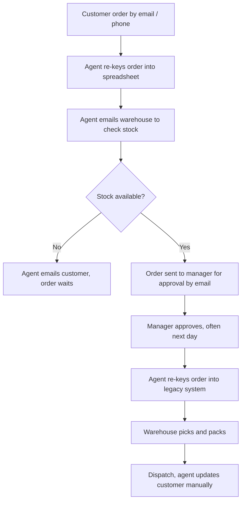
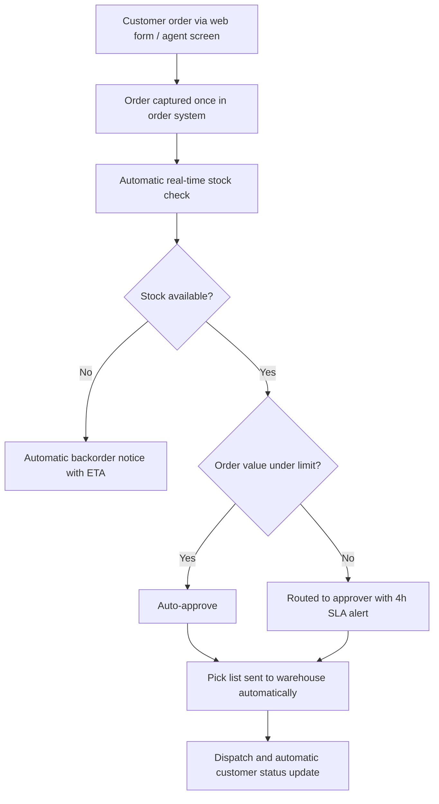

# Process flows: AS-IS vs TO-BE

## AS-IS (current process)

## TO-BE (proposed process)

## Bottleneck analysis
| Bottleneck | Cause | Impact | Fix in TO-BE |
|---|---|---|---|
| Manual re-keying (2x) | Disconnected tools | Errors, wasted time | Single capture, system integration |
| Stock check by email | No shared inventory view | Delay of hours | Real-time stock lookup |
| Approval by email | No routing or SLA | Orders wait overnight | Auto-approval rules + workflow with SLA |
| Manual customer updates | No notifications | Calls and complaints | Automated status messages |
